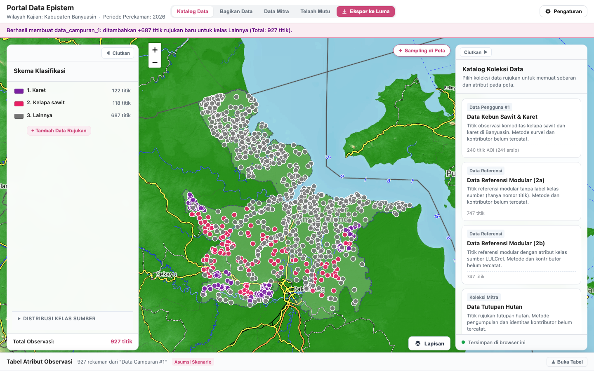
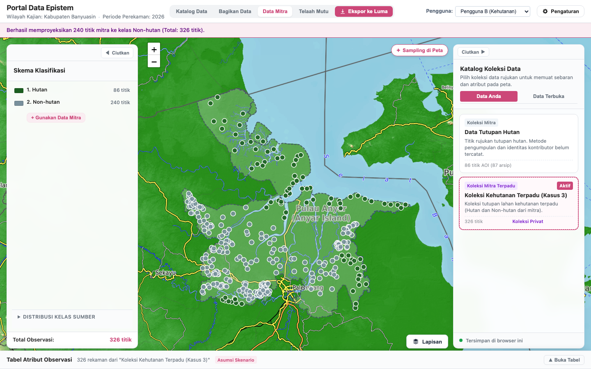

# Portal Data Epistem demo

A local browser demo for exploring land-cover reference data in Kabupaten Banyuasin, Indonesia. It demonstrates sample completion, data contribution, partner-data reuse, quality review, and export of training datasets for Luma.

The map uses Leaflet with floating, independently collapsible panels and an observation-table drawer. Prepared data is included, so developers can run the demo without GIS software, a database, or a build step.



## Clone the repository

You need Git, Python 3, and a modern browser. This repository is private, so your GitHub account needs access.

```bash
git clone https://github.com/icraf-indonesia/DemoPortalData.git
cd DemoPortalData
```

## Run on Windows

Double-click `start-windows.bat` in the cloned folder. It starts a local server and opens the browser.

Alternatively, open PowerShell in that folder and run:

```powershell
py -3 -m http.server 8765 --bind 127.0.0.1
```

If `py` is unavailable, use `python` instead. If Python is missing, install Python 3 and enable its PATH option.

## Run on macOS or Linux

From the cloned folder, run:

```bash
python3 -m http.server 8765 --bind 127.0.0.1
```

Open **http://127.0.0.1:8765/**. Keep the terminal open while using the demo. Press **Ctrl+C** to stop the server.

Opening `index.html` directly is unsupported because the application loads JavaScript modules and data through HTTP. If port 8765 is occupied, choose another port and open its matching URL.

## Explore the demo

- Use **Katalog Data** to select a collection. Under **Lainnya**, select **Tambah Data Rujukan** to complete the initial rubber and oil-palm dataset.
- Use **Bagikan Data**, **Data Mitra**, and **Telaah Mutu** to open the contribution, reuse, and review workflows.
- Select **Ciutkan** on either side panel to expose more of the map. Use its labelled button to reopen it.
- Select **Buka Tabel** at the bottom to inspect observation attributes.
- Use **Lapisan** to choose OpenTopoMap, OpenStreetMap, EOX 2025 satellite imagery, or a neutral background. Online basemaps require internet access; local observations and boundaries remain available without them.
- Use **Ekspor ke Luma** to download a training package. Private training export permits unknown metadata after acknowledgement and preserves the original values.

Drafts, review state, combinations, and display preferences are stored in the browser. They do not sync between computers or browser profiles. Changing the server port also creates a separate browser-storage origin.

## Publish data and reuse it as User B

1. As **Pengguna A**, open **Bagikan Data** from the header or an owned collection card.
2. Select the plantation or mixed collection. The mixed collection contains 240 owned observations and 687 borrowed references. Only the owned observations are published.
3. Map rubber and oil palm separately to the Epistem hierarchy. Enter the researcher name, owning institution and technical email, then accept the responsibility declaration.
4. Confirm publication and open **Data Terbuka**. The published collection contains 240 observations and supports GeoJSON download with publication metadata.
5. Switch to **Pengguna B (Kehutanan)**. Open **Data Mitra**, choose the published plantation collection and confirm reuse into Non-hutan. The private forestry collection contains 326 observations, including 86 forest points. Repeating reuse adds no duplicates.

Publication and reuse survive reload in the same browser profile and server address. They do not publish to a remote server. Publication retains the private original and queues the 240 observations for review without promoting their quality status. The user-declared observation year is 2026 for the initial rubber and oil-palm example. Missing source dates, rights and contributor fields remain unchanged.



## Develop and test

Edit `index.html`, `styles.css`, or files under `src/`, then reload the browser. Runtime libraries are vendored locally; Node.js is only needed for the JavaScript tests.

For JavaScript and browser tests, use Node.js 22 or newer:

```bash
npm ci
npx playwright install chromium
npm test
```

The browser tests use Playwright's installed Chromium by default. To use an existing compatible browser, set `PLAYWRIGHT_EXECUTABLE_PATH` to its executable path.

For the optional Python importer tests:

```bash
python3 -m venv .venv
source .venv/bin/activate
python -m pip install -r requirements-dev.txt
python -m unittest discover -s tests -v
```

On Windows, create the environment with `py -3 -m venv .venv` and activate it with `.venv\Scripts\Activate.ps1` instead of `source`.

## Project structure

| Path | Purpose |
| --- | --- |
| `src/` | Application state, map views, workflows, and export logic |
| `data/derived/` | Prepared GeoJSON, catalogue manifest, and boundary-repair audit |
| `vendor/` | Leaflet and JSZip, including their licence files |
| `scripts/prepare-data.py` | Optional importer for separately supplied source archives |
| `tests/` | JavaScript, browser, and Python importer tests |
| `docs/` | Design notes, workflow guides, and implementation history |
| `start-windows.bat` | Windows local-server launcher |

The original source archives are not needed to run the demo and are not included. To rebuild prepared data, run `python scripts/prepare-data.py --help` and provide your own source and output directories. The importer rejects invalid boundaries unless you explicitly request derived-geometry repair with `--repair-invalid-boundaries`.

## Scope and limitations

This is a demonstration, not an authenticated multi-user service. Contribution, roles, permissions, and reviews run locally. Source metadata remains unknown where absent; scenario assumptions are labelled separately. The project year is 2026. Publication records the user-declared 2026 observation year for the initial plantation example separately from unknown source dates. Basemap dates remain independent. Export packages are checked locally, but live import into Luma remains untested.

The application and browser tests have been verified on macOS. Windows launch instructions are provided; native Windows execution remains untested. Historical documents may refer to local verification artefacts under `.work`, which are excluded from this repository.
